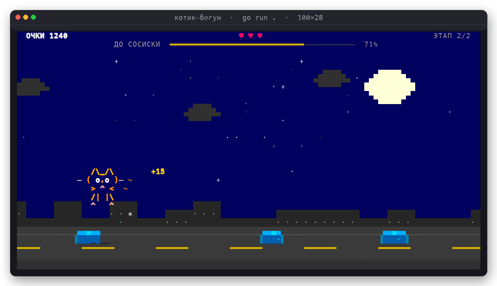
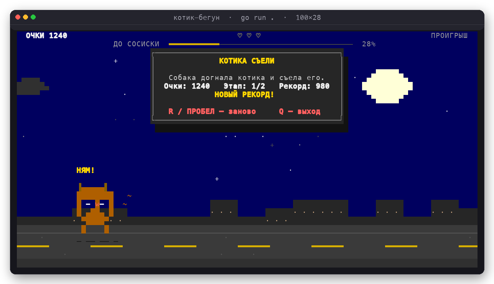
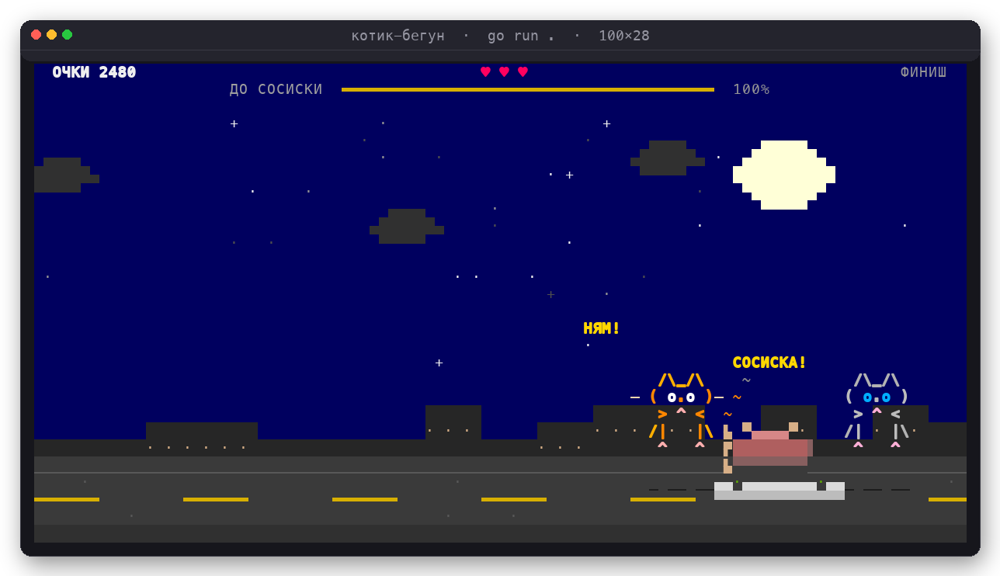
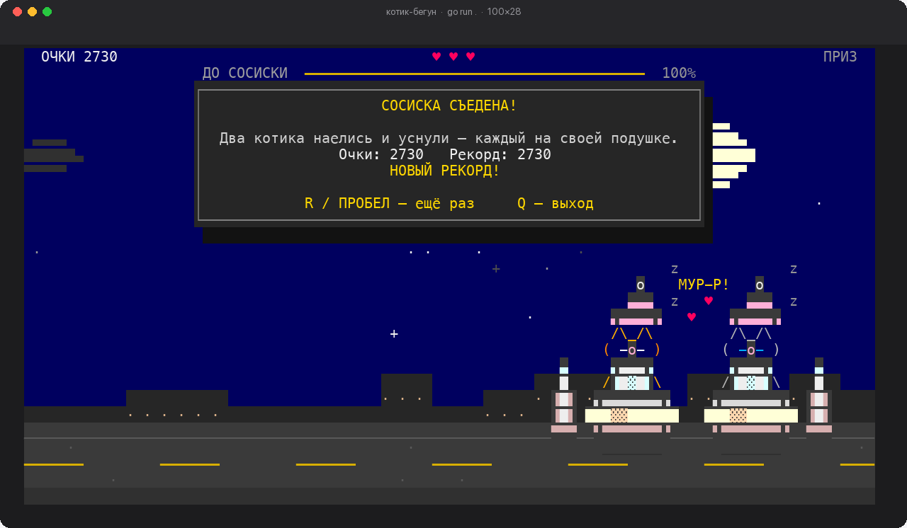

# Котик-бегун 🐾

Мини-игра для терминала на Go: котик бежит по ночной дороге через **два этапа**,
прыгает через лужи и в финале получает сосиску. Три жизни, растущая скорость и
рекорд, который сохраняется между запусками.



## Запуск

Нужен Go 1.22+ и терминал с поддержкой UTF-8 и 256 цветов (Terminal.app, iTerm2,
Ghostty, kitty, WezTerm и т. п.). Минимальный размер окна — **64×20**.

```bash
cd cat-runner
go run .
```

Или собрать бинарник:

```bash
go build -o cat-runner .
./cat-runner
```

Без сторонних зависимостей: только стандартная библиотека Go и `stty` для
перевода терминала в игровой режим (macOS/Linux).

## Управление

| Клавиша | Действие |
|---|---|
| `Пробел`, `W`, `Ц`, `↑`, `Enter` | прыжок / начать / пропустить заставку / сыграть ещё |
| `P` или `З` | пауза |
| `R` или `К` | заново на экране победы или проигрыша |
| `Q`, `Й` или `Ctrl+C` | выход |

Раскладка значения не имеет: работают и русские буквы на тех же клавишах.

## Что происходит

- Забег состоит из двух этапов. Полоса **«ДО СОСИСКИ»** показывает общий прогресс.
- Лужи катятся навстречу. Попал в лужу — минус одна жизнь. Всего их три.
- После попадания котик на секунду становится неуязвимым и мигает.
- За каждую перепрыгнутую лужу +15 очков, за первый этап +100, за сосиску +250.
- Скорость постепенно растёт, лужи становятся шире.
- Между этапами появляется заставка: её можно пропустить пробелом.

### Проигрыш

Если жизни закончились, из-за правого края выбегает **собака**, догоняет котика
и съедает его. После этого появляется экран «КОТИКА СЪЕЛИ» с очками и рекордом.



### Победа

После второго этапа управление отключается: котик сам добегает до сосиски.
К нему присоединяется **второй котик — серый**, и они вместе едят сосиску
с двух сторон.



Потом на дороге появляются две подушки — по одной на котика, рядом с каждой
ставится бутылочка молока. Котикам надевают подгузники, шапочки и сосочки.
Каждый забирается на свою подушку, сворачивается и засыпает, а над каждым
поднимаются «z».



Если не успел увернуться от лужи — будет собака. Если дошёл до конца — будут
две подушки, молоко, подгузники, шапочки, сосочки и сладкий сон.

## Рекорд

Рекорд сохраняется в `~/Library/Application Support/cat-runner/best.txt`
(macOS) или `~/.config/cat-runner/best.txt` (Linux).

## Разработка

```bash
go test ./...     # логика, отрисовка, собака, два котика и сон
go vet ./...
go run . -snapshot -screen start       # стартовый экран
go run . -snapshot -screen stageclear  # переход между этапами
go run . -snapshot -screen dog         # собака догоняет котика
go run . -snapshot -screen over        # экран «КОТИКА СЪЕЛИ»
go run . -snapshot -screen finish      # два котика едят сосиску
go run . -snapshot -screen victory     # котики спят в шапочках, с молоком и сосочками
```

Структура:

- `main.go` — запуск, игровой цикл, обработка сигналов и ресайза.
- `game.go` — физика прыжка, лужи, жизни, этапы, собака, второй котик и вся финальная сцена.
- `render.go` — canvas, ночная сцена, котики, собака, сосиска, финальная сцена (подушки, молоко, подгузники, шапочки, сосочки) и HUD.
- `term.go` — raw-режим терминала, размер окна и чтение клавиш.
- `best.go` — сохранение рекорда.
- `game_test.go`, `autoplay_test.go` — тесты, включая полный автопрогон до сна.
- `preview*.png` — кадры игры, проигрыша с собакой и победы.
